

  <a href="https://www.valorant-spind.de/spindtune.html">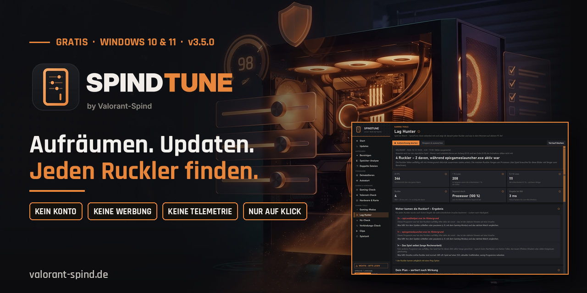</a>

  🇬🇧 <a href="README.md">English</a> · 🇩🇪 <b>Deutsch</b>

  
  
  
  
  

  <b>Kein Konto</b> · <b>Keine Werbung</b> · <b>Kein Abo</b> · <b>Keine Telemetrie</b> · <b>Nichts passiert ohne deinen Klick</b>

---

**SpindTune** ist ein kostenloses Windows-Tool von [Valorant-Spind](https://www.valorant-spind.de), mit dem du deinen **PC aufräumst, aktuell hältst und durchcheckst** – mit klarem Fokus auf Gaming. Es entfernt Datenmüll ohne Registry-Eingriffe, bringt Programme, Windows und Treiber auf den neuesten Stand, findet mit dem **Gaming-Check** versteckte Bremsen, zeigt dir mit dem **Lag Hunter**, warum dein Spiel ruckelt, und prüft mit dem **Valorant-Check** TPM 2.0, Secure Boot und alles, was Riot Vanguard braucht.

Jede Aktion siehst du, bevor sie passiert. Du entscheidest – SpindTune macht nur, was du anklickst.

  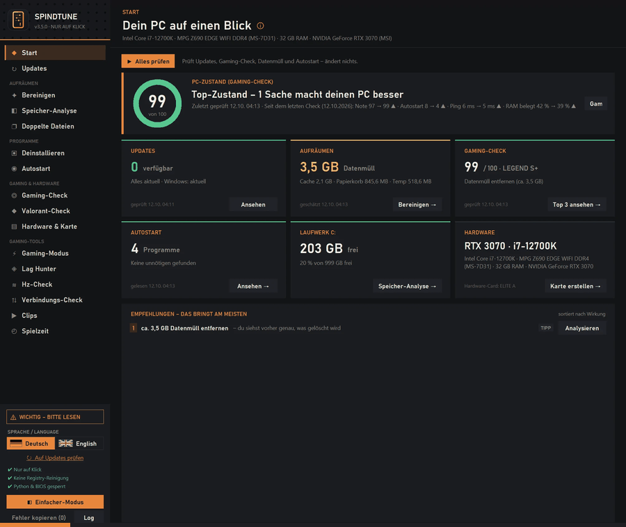
   Echte Screenshots von SpindTune 3.5.0 unter Windows 11 (12. Oktober 2026). Persönliches ist verpixelt.

## Inhalt

- [Warum SpindTune](#warum-spindtune)
- [Einfach-Modus](#einfach-modus-vier-karten-eine-note)
- [Neu in 3.5.0: Lag Hunter](#neu-in-350-der-lag-hunter)
- [Alle Funktionen](#alle-funktionen)
- [Valorant-Check](#valorant-check-tpm-20-secure-boot--vanguard)
- [Karten zum Teilen](#karten-zum-teilen)
- [Sicherheitsregeln](#was-spindtune-nie-macht)
- [Datenschutz](#datenschutz)
- [Download & Installation](#download--installation)
- [Versionen](#versionen)
- [FAQ](#faq)

## Warum SpindTune

| | |
|---|---|
| 🔒 **Deine Daten bleiben bei dir** | Keine Anmeldung, keine Telemetrie, kein Hintergrunddienst, kein Autostart. Fenster zu – SpindTune ist aus. |
| 👆 **Nur auf deinen Klick** | Geprüft, aktualisiert oder gelöscht wird erst, wenn du es auslöst und bestätigst. Jede Zeile sagt dir, *warum*. |
| 🧹 **Keine Registry-Reinigung** | Der riskante „Registry-Cleaner“ fehlt mit Absicht – auch Microsoft unterstützt Registry-Cleaner nicht. |
| ♻️ **Wo möglich umkehrbar** | Wiederherstellungspunkt vor Treibern und Bereinigung, Duplikate und Clips nur in den Papierkorb, Autostart-Einträge mit Sicherung. |
| 🎮 **Für Gamer gebaut** | Gaming-Check mit Note 0–100, Lag Hunter mit Frametime-Analyse, Valorant-Check für Vanguard, Hz-Check und mehr. |
| 💸 **Gratis. Wirklich.** | Keine Pro-Version, kein Abo, keine In-App-Käufe, keine Werbung. |

## Einfach-Modus: vier Karten, eine Note

Beim Start siehst du immer zuerst den **Einfach-Modus**. Vier große Karten beantworten die Fragen, die sich fast jeder Gamer stellt – und rechts oben zeigt der PC-Zustand (0–100), wo du stehst.

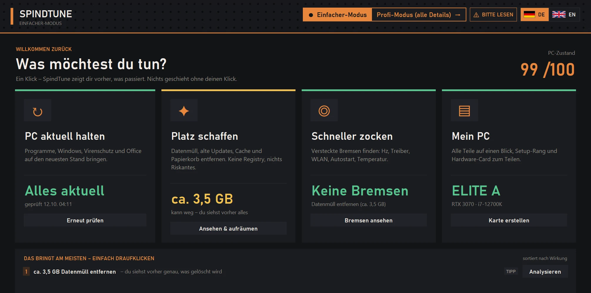

| Karte | Was sie macht |
|---|---|
| **PC aktuell halten** | Programme, Windows, Virenschutz und Office – mit einer Liste, die du vorher siehst und bestätigst. |
| **Platz schaffen** | Datenmüll, alte Update-Dateien, Caches und der Papierkorb. Keine Registry, nichts Riskantes. |
| **Schneller zocken** | Falsche Bildwiederholrate, alte Treiber, wackeliges WLAN, zu viel Autostart, Temperatur. |
| **Mein PC** | Alle Bauteile auf einen Blick, eine geschätzte Setup-Stufe und deine Hardware-Card zum Teilen. |

Du willst jedes Detail? Wechsel in den **Profi-Modus** – mit einer Seitenleiste aus **16 Seiten in sechs Gruppen**.

## Neu in 3.5.0: der Lag Hunter

**Warum ruckelt dein Spiel?** Klick auf *Aufzeichnung starten*, spiel ganz normal – nach dem Match ist der Bericht fertig:

- Ø FPS, **1-%- und 0,1-%-Lows**
- jeder Ruckler mit **Uhrzeit und wahrscheinlicher Ursache**
- ob **Grafikkarte, Prozessor oder ein FPS-Limit** gebremst hat
- welche Programme während der Ruckler liefen
- eine **Zeitleiste mit Ping** (Router und Internet) und ein Plan mit konkreten Schritten

Die Bildzeiten kommen von **Intel PresentMon 2.6.0** (MIT-Lizenz). Es wird mit SpindTune ausgeliefert, vor jedem Start auf Intels digitale Signatur geprüft und **liest nur Windows-Ereignisse – ins Spiel wird nichts eingeschleust**. Menüs und Ladebildschirme werden automatisch herausgefiltert.

<table>
  <tr>
    <td width="50%">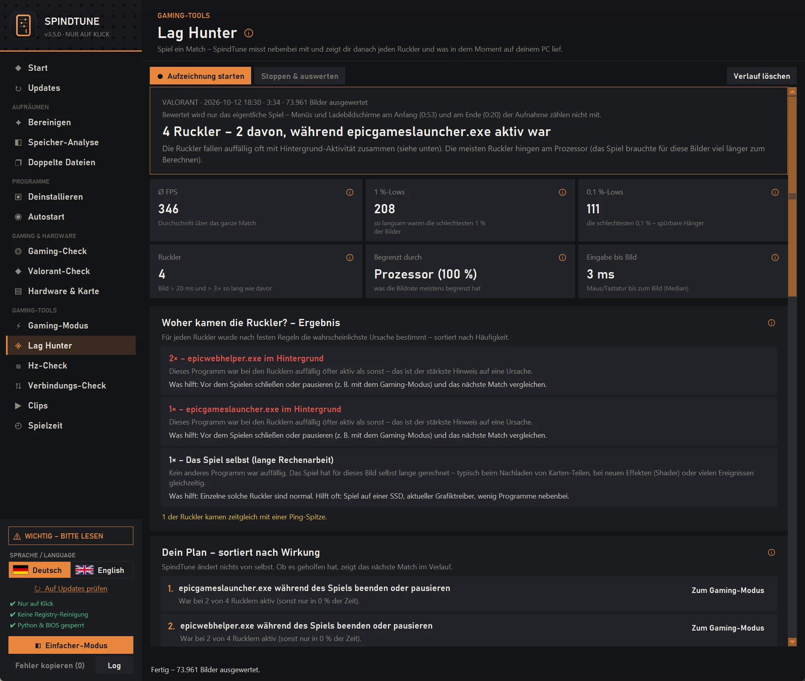</td>
    <td width="50%">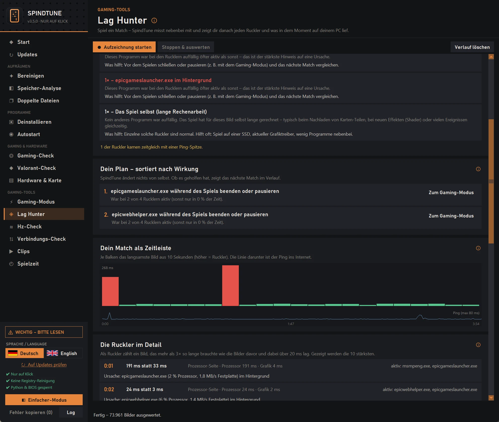</td>
  </tr>
  <tr>
    <td><b>Das Ergebnis:</b> ein echtes Valorant-Match – Ruckler, Ø FPS, Lows und was gebremst hat.</td>
    <td><b>Zeitleiste:</b> jeder Ruckler als roter Balken mit Uhrzeit und Ursache, darunter der Ping.</td>
  </tr>
  <tr>
    <td>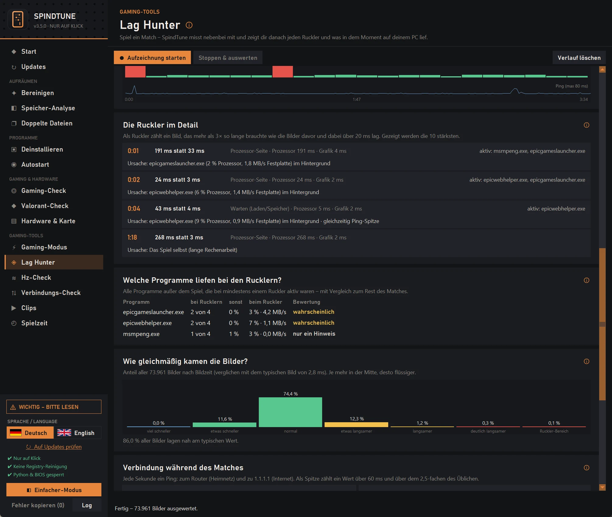</td>
    <td>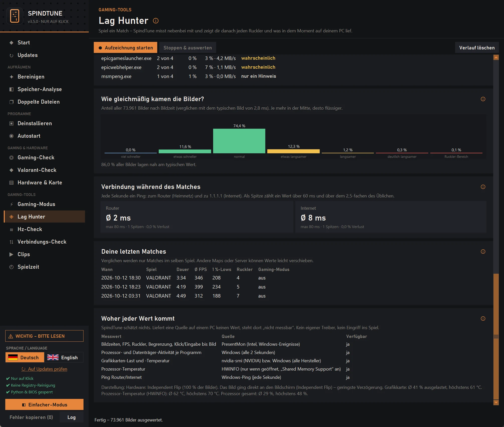</td>
  </tr>
  <tr>
    <td><b>Gleichmäßigkeit:</b> wie gleichmäßig die Bilder kamen, plus Ping zu Router und Internet.</td>
    <td><b>Verlauf & Quellen:</b> letzte Matches im Vergleich. Kein Wert? Dann steht dort „nicht messbar“ statt einer Schätzung.</td>
  </tr>
</table>

**Außerdem neu in 3.5.0:** Grafikkarten-Temperatur und -Last für NVIDIA, AMD und Intel direkt aus Windows, Prozessor-Temperatur über das kostenlose Tool HWiNFO (auf Wunsch), ein höflicherer Gaming-Modus über den Windows-Neustart-Manager, eine strengere Sperrliste beim Bereinigen, ⓘ-Erklärungen auf jeder Seite und ein neu geschriebenes Sicherheitsfenster.

## Alle Funktionen

<table>
  <tr>
    <td width="50%" valign="top">
      <h3>🏠 Start</h3>
      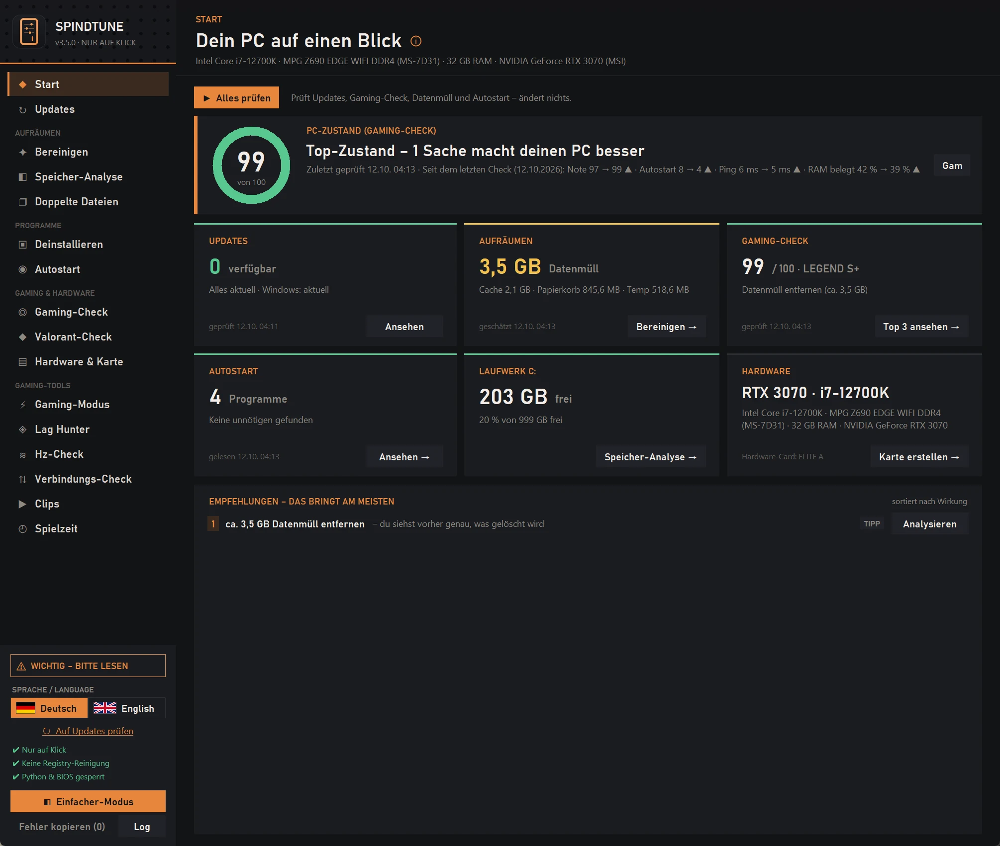
      
<b>Alles prüfen</b> in rund 2–4 Minuten – Updates, Gaming-Bereitschaft, Datenmüll und Autostart – ohne etwas zu ändern.

    </td>
    <td width="50%" valign="top">
      <h3>🔄 Updates</h3>
      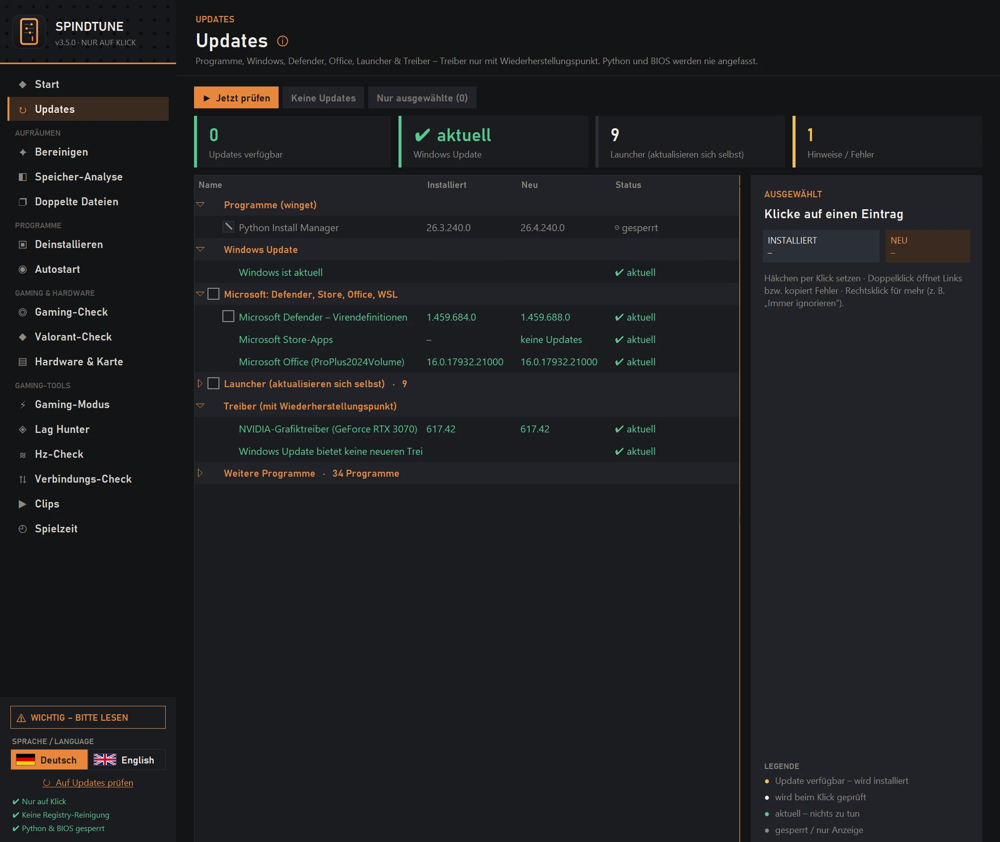
      
Programme über <b>winget</b>, <b>Windows Update</b>, Defender, Store, Office, WSL, Launcher und <b>Grafiktreiber direkt von NVIDIA oder AMD</b>. Treiber nur mit Wiederherstellungspunkt.

    </td>
  </tr>
  <tr>
    <td valign="top">
      <h3>🧹 Bereinigen</h3>
      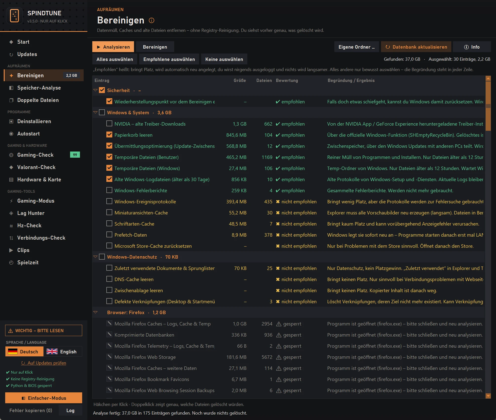
      
Erst analysieren, dann löschen. Temp-Dateien, alte Update-Downloads, Caches, Speicherabbilder. Nutzt die Datenbank <a href="https://github.com/MoscaDotTo/Winapp2">Winapp2</a> (4.068+ Programme) – <b>nur Dateiregeln, Registry-Regeln werden immer übersprungen</b>.

    </td>
    <td valign="top">
      <h3>🎮 Gaming-Check</h3>
      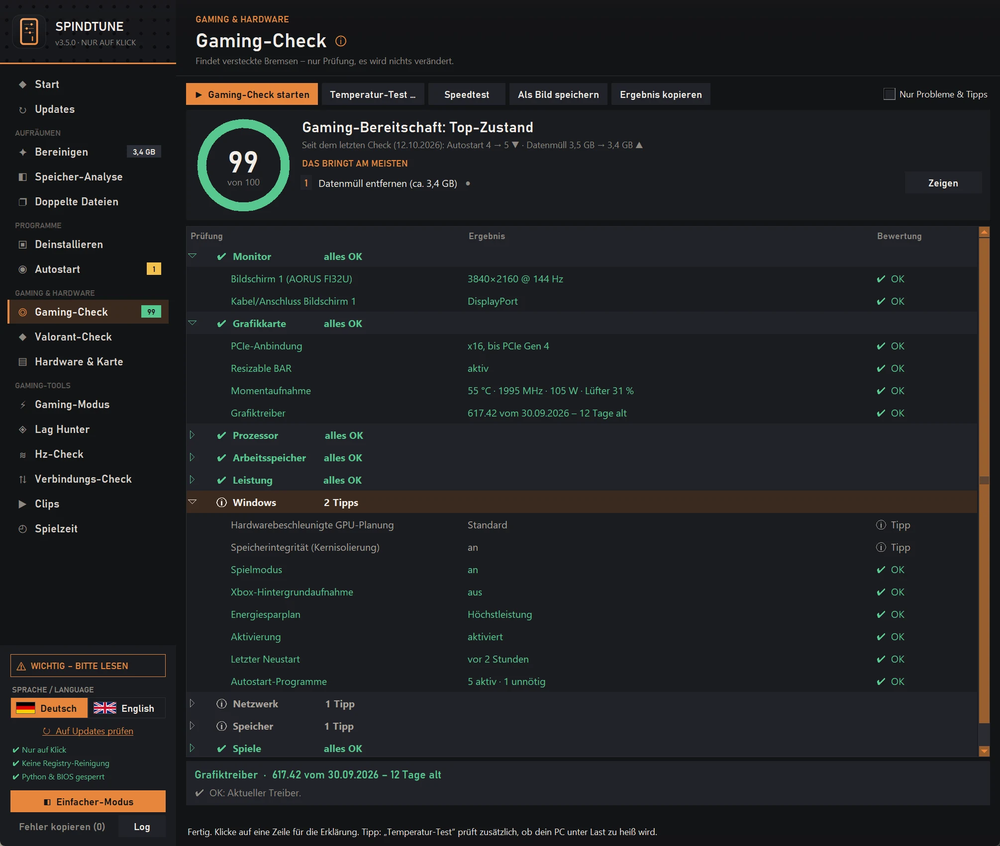
      
Zwölf Bereiche in rund 30 Sekunden: Monitor-Hz, RAM-Dual-Channel und XMP/EXPO, PCIe und Resizable BAR, Treiber-Alter, Windows-Einstellungen, Ping & WLAN, SSD-Zustand. Note von ROOKIE (D) bis LEGEND (S+).

    </td>
  </tr>
  <tr>
    <td valign="top">
      <h3>⚡ Gaming-Modus</h3>
      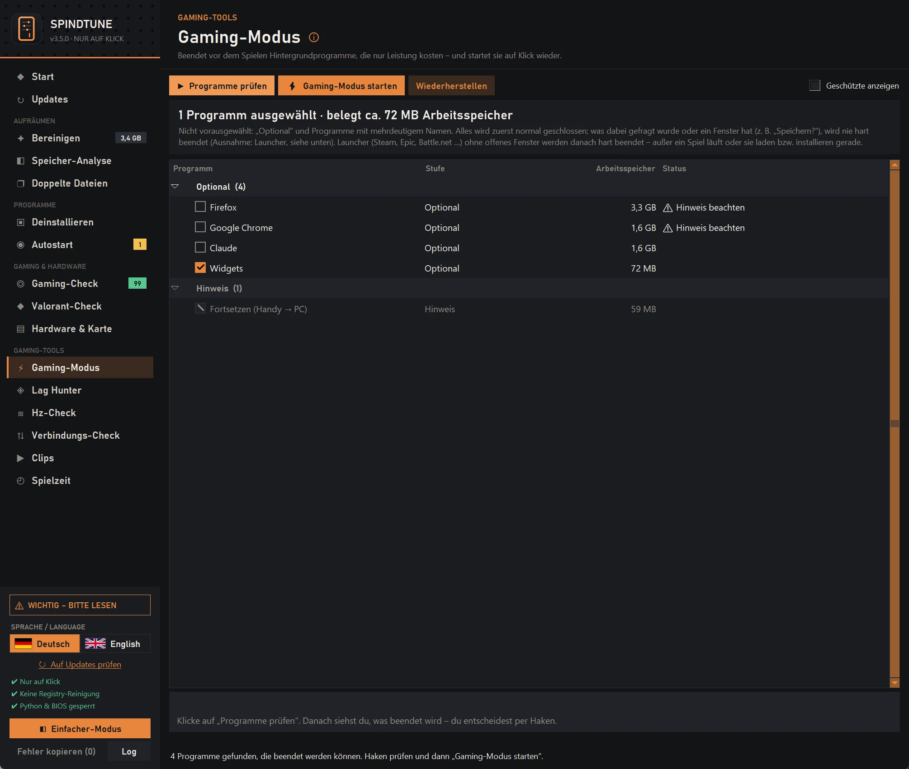
      
Chat-Apps, Launcher, Updater und Cloud-Sync vor dem Zocken schließen – du wählst per Haken, <b>Wiederherstellen</b> startet alles wieder. Spiele, Anti-Cheat, Treiber und Windows werden nie angefasst.

    </td>
    <td valign="top">
      <h3>🖥️ Hardware & Karte</h3>
      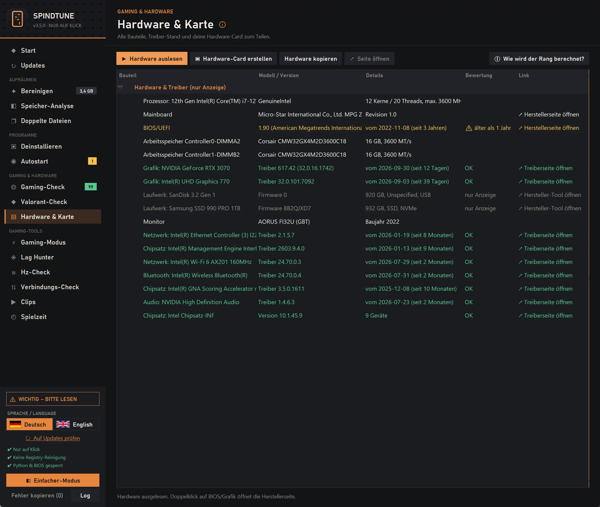
      
CPU, Mainboard mit BIOS-Datum, RAM pro Slot, Grafikkarten, Laufwerke mit Firmware und alle wichtigen Treiber mit Alter – jeweils mit Link zum Hersteller.

    </td>
  </tr>
  <tr>
    <td valign="top">
      <h3>📺 Hz-Check</h3>
      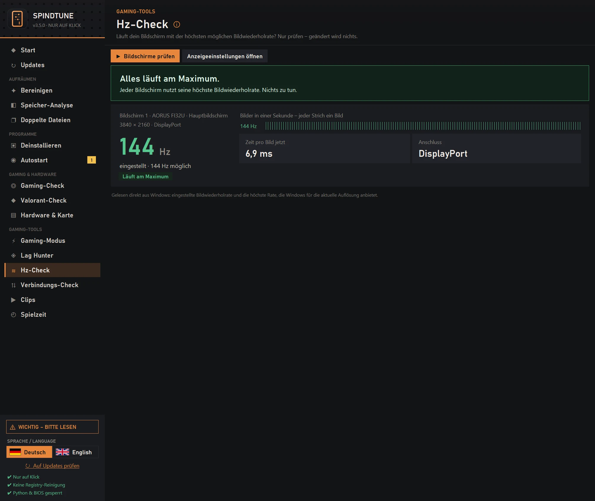
      
Läuft dein Monitor wirklich mit 144, 165 oder 240 Hz? Zeigt, was eingestellt ist, was möglich wäre und ob Kabel oder Anschluss bremsen.

    </td>
    <td valign="top">
      <h3>📶 Verbindungs-Check</h3>
      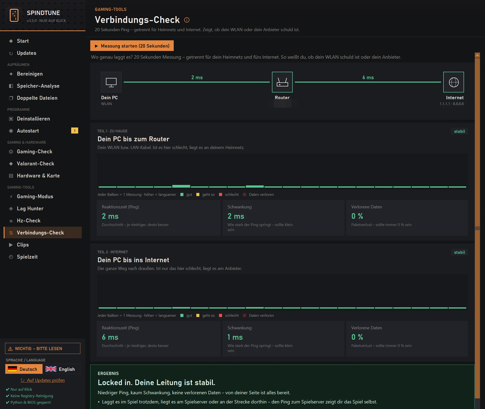
      
20 Sekunden Ping, getrennt für dein Heimnetz und das Internet – so weißt du, ob das WLAN oder dein Anbieter die Lags verursacht.

    </td>
  </tr>
  <tr>
    <td valign="top">
      <h3>💾 Speicher-Analyse & Duplikate</h3>
      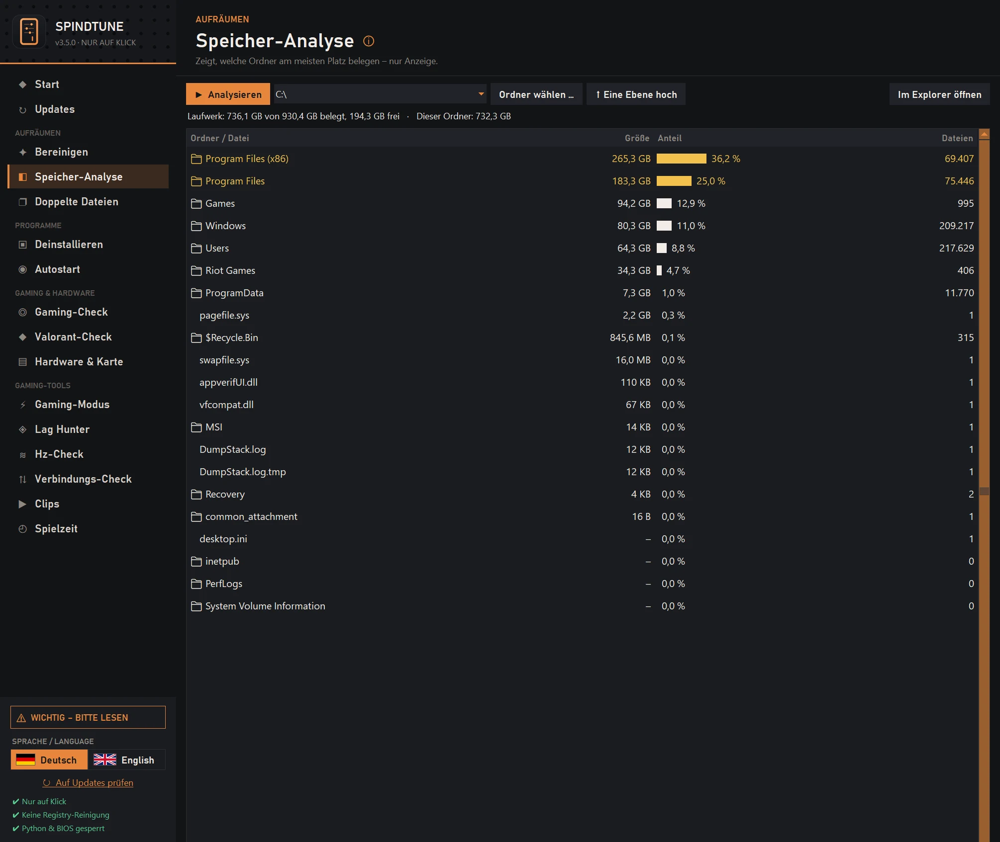
      
Sieh, welche Ordner deine Platte füllen (nur Anzeige). Doppelte Dateien findet identische Dateien per Prüfsumme, behält immer eine pro Gruppe und verschiebt den Rest nur in den Papierkorb.

    </td>
    <td valign="top">
      <h3>🚀 Autostart & Deinstallieren</h3>
      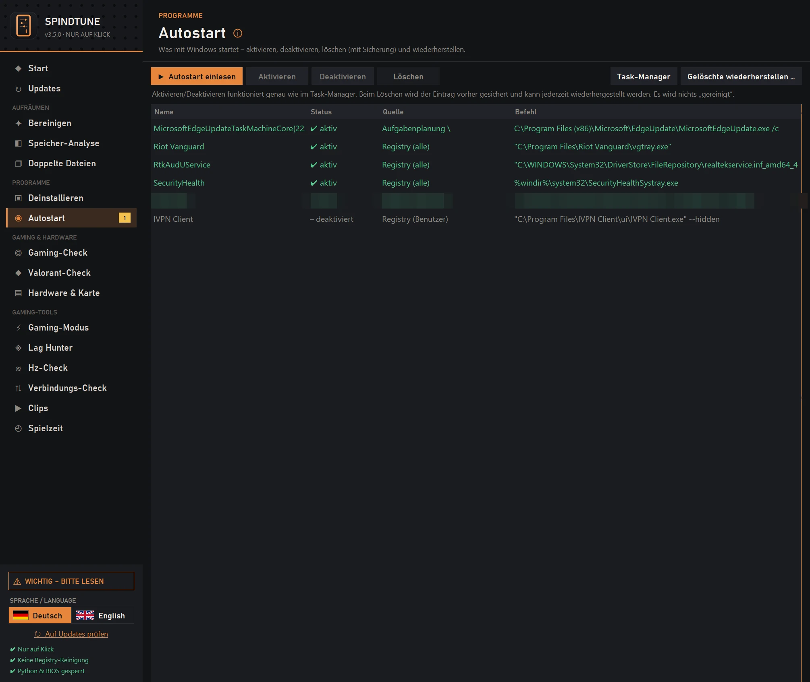
      
Autostart-Einträge aktivieren und deaktivieren wie im Task-Manager, mit Sicherung vor dem Löschen. Deinstallieren läuft immer über das offizielle Deinstallationsprogramm.

    </td>
  </tr>
  <tr>
    <td valign="top">
      <h3>🎬 Clips</h3>
      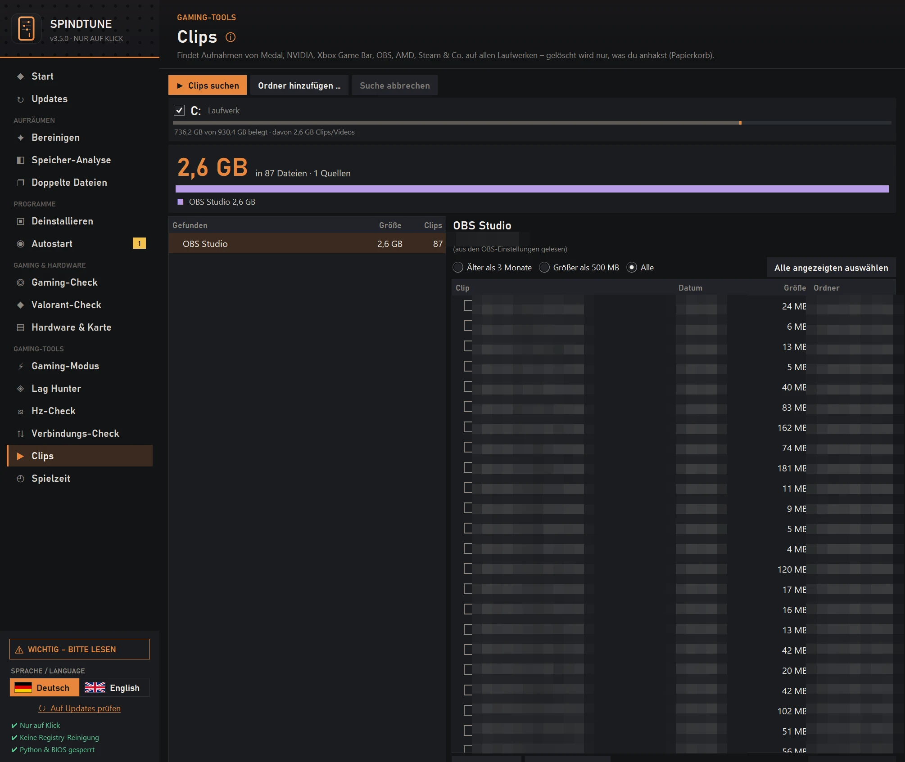
      
Findet Aufnahmen von Medal, NVIDIA, Xbox Game Bar, OBS, AMD, Steam & Co. auf deinen Laufwerken – nur was du anhakst, wandert in den Papierkorb.

    </td>
    <td valign="top">
      <h3>⏱️ Spielzeit</h3>
      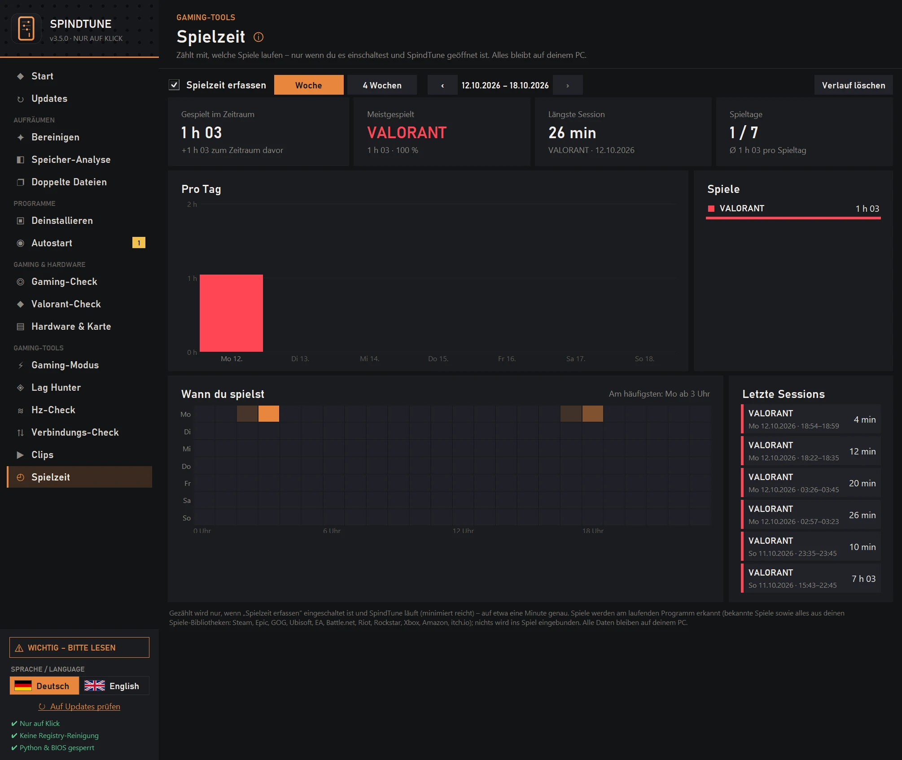
      
Optional und lokal: Spielzeit pro Tag, wann du meistens spielst und deine letzten Sessions – nur wenn du es einschaltest und SpindTune offen ist.

    </td>
  </tr>
</table>

## Valorant-Check: TPM 2.0, Secure Boot & Vanguard

Unter Windows 11 startet Valorant nur mit **TPM 2.0** und **UEFI Secure Boot**. Fehlt etwas, zeigt Vanguard Fehler wie **VAN 9001** oder **VAN 9003**. Der Valorant-Check prüft in 10–30 Sekunden alles, was Vanguard braucht – **nur lesend, es wird nichts geändert**:

- Windows-Version, UEFI/Legacy, Partitionsstil (GPT/MBR), Secure Boot inkl. Schlüssel und Zertifikat 2023
- TPM-Version und -Status – Intel PTT, AMD fTPM, Microsoft Pluton oder separater Chip
- Control Flow Guard, Testmodus, VT-x/AMD-V, VBS, Speicherintegrität (HVCI), Kernel-DMA-Schutz (IOMMU)
- Vanguard-Dienste `vgc` und `vgk` sowie ein Lexikon mit **27 VAN-Fehlercodes**

Die Anleitungen passen zu deiner Hardware, mit konkreten BIOS-Pfaden für ASUS, MSI, Gigabyte und ASRock und typischen Pfaden für Dell, HP, Lenovo und Acer. Ist BitLocker an, erinnert dich SpindTune vorher daran, deinen Wiederherstellungsschlüssel zu sichern.

<table>
  <tr>
    <td width="50%">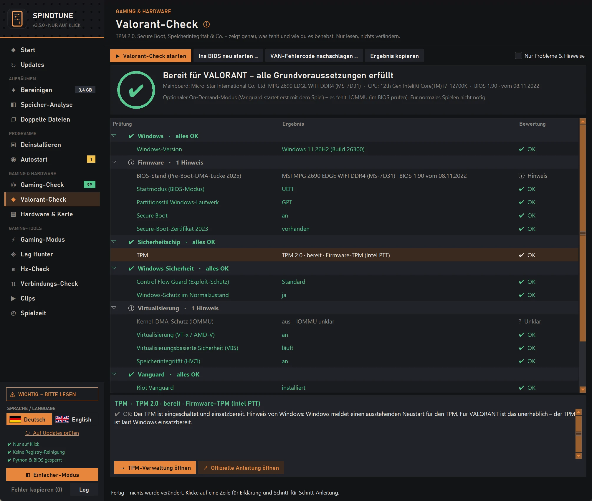</td>
    <td width="50%">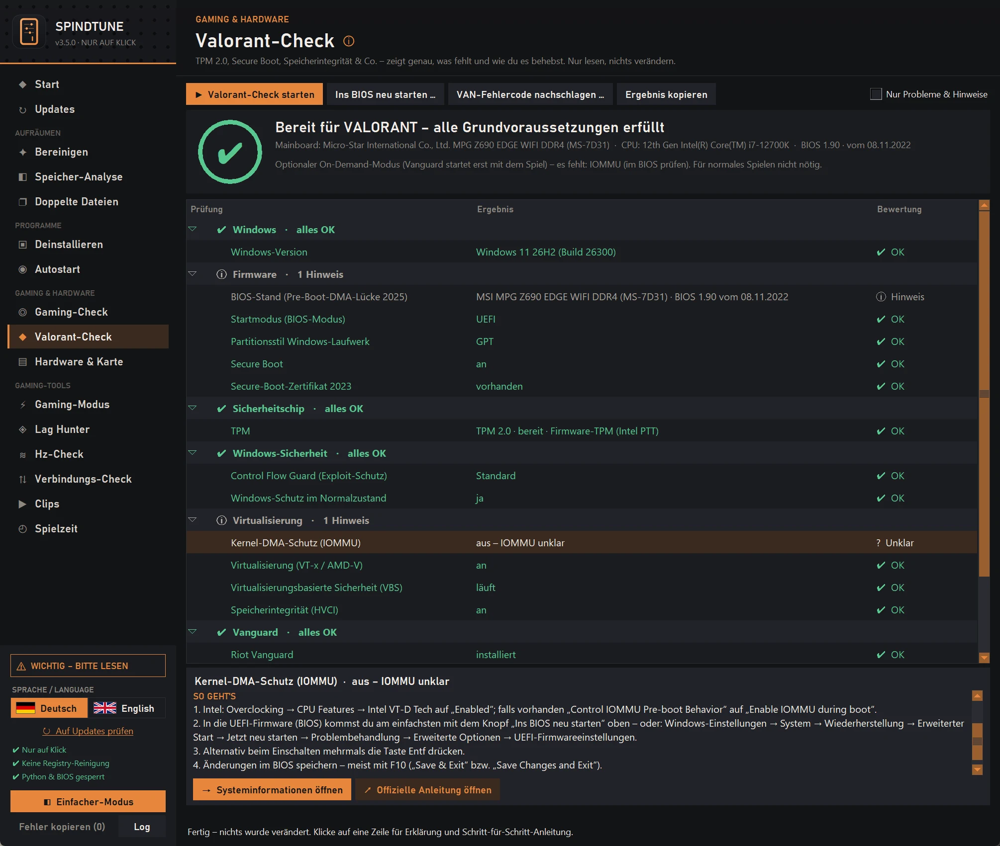</td>
  </tr>
</table>

Die komplette Anleitung ohne Tool: [Valorant: Secure Boot & TPM 2.0 aktivieren](https://www.valorant-spind.de/valorant-secure-boot-tpm.html) · [VAN-Fehlercodes](https://www.valorant-spind.de/valorant-van-fehlercodes.html)

## Karten zum Teilen

Speichere deinen **Gaming-Check**, deine **Hardware-Card** und deinen **Speedtest** als JPG oder PNG (bis 2.160 × 2.700 Pixel) – fertig für Discord, Reddit oder Instagram. Seriennummern, Benutzername, IP- und MAC-Adressen landen nie auf einer Karte.

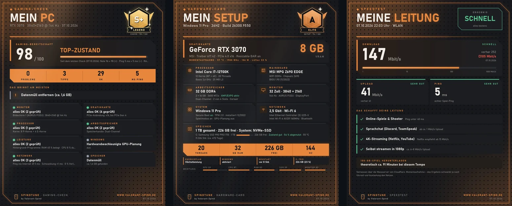

## Was SpindTune nie macht

SpindTune zeigt seine Regeln nach jeder Installation und jeder neuen Version – du bestätigst sie mit zwei Haken.

<table>
  <tr>
    <td width="55%" valign="top">

**So ist jede Aktion abgesichert**

- **Treiber:** Wiederherstellungspunkt Pflicht, nur von freigegebenen Hersteller-Seiten, Signatur geprüft
- **Bereinigen:** Wiederherstellungspunkt standardmäßig an, Dateiliste vorher
- **Doppelte Dateien & Clips:** nur in den Papierkorb
- **Autostart:** Sicherung vor dem Löschen, Wiederherstellen mit einem Klick
- **Nie zwei Aktionen gleichzeitig** – eine globale Sperre verhindert Konflikte

**Niemals**

- nichts automatisch, nichts im Hintergrund
- keine Registry-Reinigung
- keine BIOS-, UEFI- oder SSD-Firmware-Updates, keine Python-Updates
- keine Wiederherstellungspunkte löschen, keine DISM-Bereinigung

</td>
    <td width="45%" valign="top">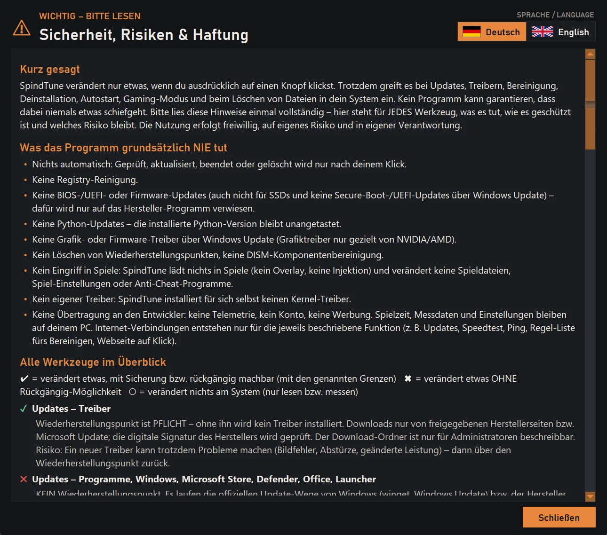</td>
  </tr>
</table>

Ehrlich bei den Grenzen: App-Updates und Deinstallationen laufen über die offiziellen Wege der Hersteller und legen keinen eigenen Wiederherstellungspunkt an; bereinigte Dateien und ein geleerter Papierkorb sind endgültig weg. Wenn du einen Punkt nicht verstehst, lass ihn einfach weg – die Begründung steht in jeder Zeile.

## Datenschutz

SpindTune enthält **keine Telemetrie** und schickt **keine Daten über dich** an uns. Ins Internet geht es nur, wenn du eine Funktion startest, die das braucht – zum Beispiel Updates über Microsoft (winget, Windows Update), Treiber direkt von NVIDIA oder AMD, Spiele-Anforderungen aus dem Steam-Store, den Speedtest über Cloudflare, den Ping im Lag Hunter (Router und `1.1.1.1`) oder das Update der Bereinigungs-Datenbank von GitHub. Einstellungen liegen lokal unter `%LOCALAPPDATA%\SpindTune`.

Alle Details: [Datenschutzerklärung, Abschnitt „SpindTune“](https://www.valorant-spind.de/datenschutz.html#spindtune)

## Download & Installation

  

| | |
|---|---|
| **Version** | 3.5.0 (12. Oktober 2026) |
| **System** | Windows 10 & 11, 64-Bit |
| **Größe** | 18,0 MB (`SpindTune-Setup.exe`, Setup-Assistent) |
| **Sprachen** | Deutsch & Englisch – Wahl im Setup, in der App umschaltbar |
| **Rechte** | Administrator (nötig für Updates, Treiber, Wiederherstellungspunkte und Systemordner) |
| **Preis** | kostenlos – kein Abo, kein Konto |
| **SHA-256** | `e7c0ad024744cd04add7338be70810e24c33fe09e0cfb5bebec2580fedc8392a` |

1. **Herunterladen:** `SpindTune-Setup.exe` von der [offiziellen Seite](https://www.valorant-spind.de/spindtune.html#download) – lade SpindTune nur von valorant-spind.de.
2. **Prüfen** (optional) in PowerShell: `Get-FileHash .\SpindTune-Setup.exe`
3. **Installieren** – die Datei ist (noch) nicht digital signiert, SmartScreen kann deshalb „Unbekannter Herausgeber“ melden → *Weitere Informationen* → *Trotzdem ausführen*.
4. **Sicherheitshinweise lesen**, beide Haken setzen und im Einfach-Modus loslegen.

**VirusTotal:** Stand 13. Oktober 2026 melden 68 von 71 Virenscannern keinen Fund ([Prüfbericht](https://www.virustotal.com/gui/file/e7c0ad024744cd04add7338be70810e24c33fe09e0cfb5bebec2580fedc8392a)). Trellix und Skyhigh („Artemis“, eine Cloud-Reputationsbewertung) sowie Deep Instinct (KI-Bewertung) schlagen an – wir gehen von Falschmeldungen aus, weil Reputations- und KI-basierte Erkennungen neue, nicht signierte und noch selten geladene Setups öfter als verdächtig einstufen.

**Deinstallieren:** Einstellungen → Apps → Installierte Apps → SpindTune → Deinstallieren.

## Versionen

| Version | Datum | Highlights |
|---|---|---|
| **3.5.0** | 12.10.2026 | **Lag Hunter** (Bildzeiten über Intel PresentMon, 1-%/0,1-%-Lows, Ruckler-Ursachen, Ping-Zeitleiste), Grafikkarten-Temperatur für alle Hersteller, Prozessor-Temperatur über HWiNFO, höflicherer Gaming-Modus, strengere Bereinigung, ⓘ-Erklärungen, neues Sicherheitsfenster |
| **3.4.0** | 11.10.2026 | **Gaming-Modus**, **Hz-Check**, **Verbindungs-Check**, **Clips**, **Spielzeit** |
| **3.3.0** | 08.10.2026 | Setup auf Deutsch & Englisch, die App startet in der Setup-Sprache |
| **3.2.0** | 07.10.2026 | Erstes öffentliches Release |

## FAQ

<b>Ist SpindTune wirklich kostenlos?</b>

Ja. Kein Abo, keine Pro-Version, keine In-App-Käufe und keine Werbung. Es ist ein privates Projekt von Valorant-Spind.

<b>Liegt der Quellcode auf GitHub?</b>

Nein. SpindTune ist kostenlos nutzbar, aber nicht quelloffen. Dieses Repository ist das Schaufenster des Projekts – Screenshots, Funktionen, Versionen und Links. Den Download gibt es nur auf [valorant-spind.de](https://www.valorant-spind.de/spindtune.html#download).

<b>Reinigt SpindTune die Registry?</b>

Nein, mit Absicht. SpindTune überspringt auch die Registry-Regeln der Winapp2-Datenbank. Nur die Autostart-Verwaltung ändert Autostart-Einträge – so wie der Task-Manager – und nur auf deinen Klick.

<b>Behebt SpindTune VAN 9001 / VAN 9003 automatisch?</b>

Nein. Der Valorant-Check liest nur und zeigt, was fehlt – mit Schritt-für-Schritt-Anleitung für dein Mainboard. Die Schalter im BIOS setzt du selbst. Auf Wunsch startet SpindTune deinen PC nach einer Sicherheitsabfrage direkt ins BIOS.

<b>Greift der Lag Hunter ins Spiel oder Anti-Cheat ein?</b>

Nein. Die Bildzeiten kommen von Intel PresentMon, das nur Windows-Ereignisse liest – ins Spiel wird nichts eingeschleust. Die Last pro Programm kommt aus der Windows-Prozessliste, ohne Programme zu öffnen.

<b>Warum warnt Windows SmartScreen?</b>

SpindTune ist (noch) nicht digital signiert. SmartScreen meldet neue, nicht signierte Programme deshalb oft als „Unbekannter Herausgeber“. Lade SpindTune nur von valorant-spind.de und vergleiche bei Bedarf die SHA-256-Prüfsumme.

Weitere Fragen: [SpindTune-FAQ](https://www.valorant-spind.de/spindtune.html#faq) · Hilfe und Fehlermeldungen in den **SPIND-TUNE**-Kanälen auf [Discord](https://discord.com/invite/rKqNGPE3hS)

## Mehr von Valorant-Spind

- 🗄️ [**Valorant-Spind App**](https://github.com/Valorant-Spind/Valorant-Spind/blob/main/README.de.md) – wie viel ist dein Valorant-Spind wert? Spind-Wert, Coach, 2D-Match-Replay – gratis für Windows.
- 🌐 [**valorant-spind.de**](https://www.valorant-spind.de) – 40+ kostenlose Valorant-Tools: [Crosshair-Generator](https://www.valorant-spind.de/valorant-crosshair-generator.html), [Sensitivity-Converter](https://www.valorant-spind.de/valorant-sensitivity-converter.html), [Systemanforderungen](https://www.valorant-spind.de/valorant-systemanforderungen.html), [Technik-Fix](https://www.valorant-spind.de/valorant-technik-fix.html) und mehr.
- 💬 [**Discord**](https://discord.com/invite/rKqNGPE3hS) – SpindTune-Changelog, Hilfe und Community.

---

  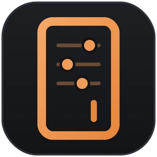 
  SpindTune ist ein unabhängiges Projekt von <a href="https://www.valorant-spind.de">Valorant-Spind</a> und kein offizielles Produkt von Riot Games, Microsoft, NVIDIA, AMD oder Intel. VALORANT ist eine Marke von Riot Games, Inc. 
  Bereinigungs-Datenbank: <a href="https://github.com/MoscaDotTo/Winapp2">Winapp2</a> (CC BY-SA 4.0) · Bildzeit-Messung: Intel PresentMon 2.6.0 (MIT-Lizenz) 
  Nutzung auf eigene Verantwortung – <a href="https://www.valorant-spind.de/impressum.html">Haftungsausschluss & Nutzungsbedingungen</a> · <a href="https://www.valorant-spind.de/datenschutz.html#spindtune">Datenschutz</a>

